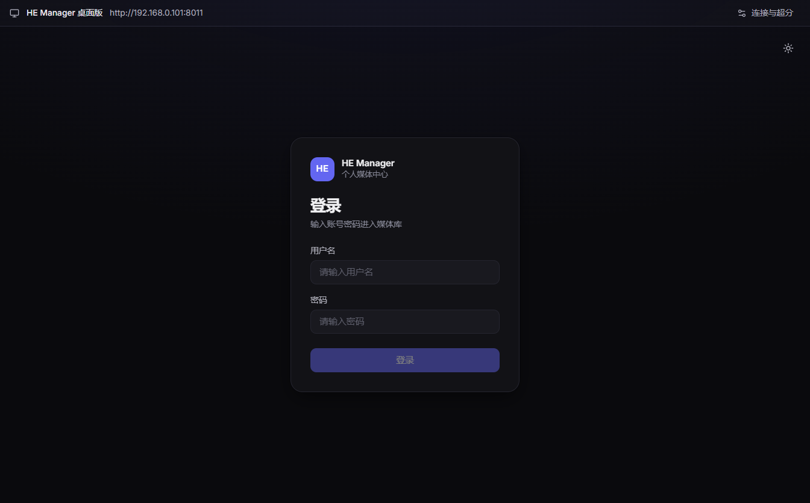

# CP-00 基线与范围交付 — 2026-10-17

状态：**通过 CP-00**。两台目标机、实际客户端启动/初始界面、资源清单、工具链、性能口径与缺口均已建立。按方案第 12 节的本阶段标准交付：能说明两端现状、支持范围与缺口；不代表后续媒体链路已通过。

## 要求与证据

| 要求 | 当前证据 |
| --- | --- |
| 固定源码 | 正式 `kazalter/HE_manager`，共用 `desktop` 和 `frontend`；无另一套 Windows UI。JSON 保存实际源码/UI/锁文件 SHA-256，采集时尚未提交，需以指纹而非基线 commit 单独认定。 |
| Windows 目标机 | Windows 11 build 26200 x64；Ryzen 7 7745HX / 32 GB；RTX 5070 Laptop / 驱动 32.0.16.1692。实际 Electron renderer 是 NVIDIA D3D11，GPU 合成/视频解码启用。 |
| Mac 目标机 | macOS 27.0 / 26A428 arm64；M1 Pro 8 CPU / 14 GPU，16 GiB；实际 Metal renderer，Retina DPR 2。 |
| 最低目标与已测范围 | 首版最低工程目标：Windows 11 24H2 x64（26100）和 macOS 15 arm64；真机验证仅覆盖上述实际系统，最低版本验收进入 CP-07。Electron 最低 macOS 13，但实际 mpv Mach-O 的 `minos=15.0`；图片引擎含原生 arm64 slice。CP-01 新运行库/桥若提高要求必须重新记录。 |
| 工具链 | 开发/CI Node 22；前端在 22.22.0 通过。Windows Node 24.15.0、MSVC 14.44.35207、SDK 10.0.26100.0 已核实；Mac Xcode/clang 21.0.0 可用。Electron 固定 44.8.0 / 内置 Node 24.22.0。原生桥实际编译版本由 CP-01 记录。 |
| 当前功能状态 | 两端实际启动、preload、登录表单、公共连接检查、原画默认值均通过；新临时 profile 不读取原账号。旧独立播放器/图片增强历史证据保留在 `VALIDATION.md`，本轮未重复，不移记为新链路结果。 |
| 界面/资源清单 | 两端实际截图已检查。Mac 150 个条目 / 187,737,354 字节；Windows 42 个 / 180,902,969 字节。来源、版本和下载 SHA 在 `runtime-lock.json`，实际文件 SHA 在平台报告；未发现可直接加载的 libmpv 动态库。 |
| 基准内容 | 原型使用已提交的合成 H.264 640×360/24fps/8 秒视频和 128×128 PNG，哈希见资源报告；CP-01 使用独立测试服务器鉴权流，后续代表格式矩阵按方案 CP-04/06 执行。 |
| 性能与缺口 | 三次独立进程、同一 UI/服务器、完整进程工作集和启动累计 CPU 快照已建立。登录后媒体库性能归 CP-03；视频计数器归 CP-01/04，图片内存预算归 CP-05，最低系统分发测试归 CP-07，均未冒充已测。 |

最低工程目标是支持政策和构建约束；它与“已在目标最低版本运行”是两件事，后者未验证。本阶段识别并固定这些验收范围，不借此提前关闭后续关卡。

## Windows -1 根因及修复

独立 `http://…` 参数后再跟其他参数，被 Electron 的 Windows 安全检查在 JS 入口前拒绝。最小矩阵中 URL 后带参数返回 `4294967295`，URL 放最后或改为 `--名称=值` 均返回 0。

固定版本源码依据：[安全检查](https://github.com/electron/electron/blob/v44.8.0/shell/app/command_line_args.cc)、[失败返回 -1 的入口](https://github.com/electron/electron/blob/v44.8.0/shell/app/electron_main_win.cc)。与 GPU、缺 DLL、WinUI 均无关。

npm 启动脚本现在先校验参数，再以无 shell 的 spawn 规范化值；安装包说明采用等号格式。新增回归覆盖 URL、重复值、空值、含空格/等号路径与凭证地址拒绝。未禁用安全检查、sandbox 或 GPU。完整 Windows 应用随后连续三次正常启动，服务器 reachable，登录表单可见，退出 0；临时入口标记已清除。

## 初始性能口径

新进程/独立临时 profile，OS 文件缓存不受控；服务器固定 `http://192.168.0.101:8011`。shell 就绪定义为桥与桌面栏存在；其后 1.5 秒确认登录表单、截图并采集资源。它不是完整媒体库首屏，也不是控制缓存的冷启动。

| 3 轮结果 | Mac arm64 | Windows x64 |
| --- | --- | --- |
| Electron ready → shell，中位数 | 355 ms | 316 ms |
| process uptime → shell，中位数 | 422 ms | 470 ms |
| 初始工作集之和，范围 | 464–494 MiB | 394–398 MiB |
| 同一 shell 流程的后续初始回归上限 | 655 ms | 616 ms |

上限为 `max(基线中位数×1.5, 基线中位数+300ms)`，是测量后设定的工程目标，只用于相同流程。完整库/播放/增强各自建立基线。工作集相加重复计算共享页，不是物理内存独占量；首次 CPU 百分比零无采样区间，不能推导空闲 CPU 为零。原始启动累计 CPU 时间仍保留。

证据：[三轮结果](CP-00-repeat.json)、[Mac JSON](CP-00-mac-arm64.json)、[Windows JSON](CP-00-windows-x64.json)。

## 回归与下一阶段

- 桌面：Mac/Windows 各 19/19；Windows 完整应用正常 GPU 模式运行通过。
- 前端：Node 22.22.0 下 116/116，TypeScript/Vite 构建通过；没有为 Node 26 的测试环境问题改业务逻辑。
- 最终源码/UI 指纹匹配、报告可读、截图已审阅、`git diff --check` 通过。
- Linux 生产容器、数据库、媒体和部署中的 Web 未改动；Windows 临时诊断任务交付时注销。

接下来 CP-01 固定 libmpv 和头文件，原型验证 Windows D3D11/NT HANDLE、Mac OpenGL/IOSurface，共享纹理导入、DOM 覆盖、有界引用释放与同会话全屏。最终进程形态、受保护流和两端最小运行包均通过才可关闭 CP-01。
