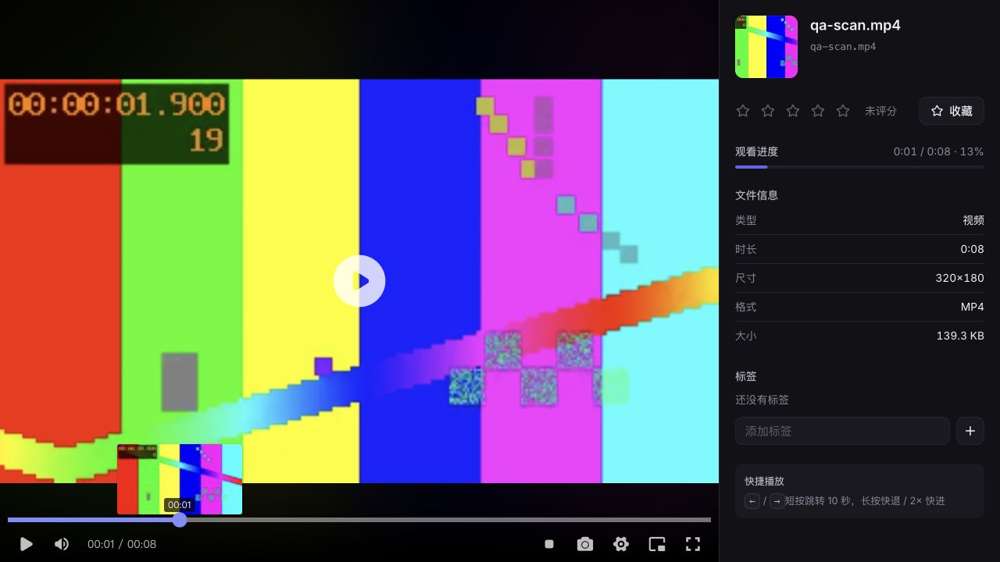

# 2026-10-22 日常 QA：视频扫描与进度条预览

基线：`main` / `2cb24f7`。改动在 Linux 独立 worktree 与 `qa/2026-10-22-media-correctness` 分支完成；生产工作区、配置备份、数据库、媒体和容器均未改动，没有合并或部署。

## 检查范围与发现

阅读 `AGENTS.md`、`PLAN.md`、`FEATURE_PLANS.md`、结构审查记录与近期提交；核对 Git 状态、开放 PR、线上健康。源码抽查媒体列表/API、进度与播放、Range、音轨、漫画页面、扫描、去重和外部来源入库；运行后端、前端、桌面核心回归和前端构建。本轮优先闭环有实际复现的视频扫描问题，不将抽查和自动测试当成所有功能的人工验收。

发现：自动模式和视频模式中的新视频被逐文件异常处理跳过，但目录状态仍回到 `idle`，用户看到扫描成功却没有视频。

- 封面函数第三、第四参数是可选的 semaphore / cv2 实现，调用方却传入预览开关和间隔，导致 `bool` 不能作为上下文管理器。
- 函数返回 `(success, time_ms, source)` 元组，调用方却按字典读取；失败元组本身也是真值。
- 预览生成函数要求文件基名、输出目录和采样间隔，调用方却传入图片路径、VTT 路径和视频总时长。命名还与 Web 从 `cover_path` 推导 VTT URL 的方式不符。
- 进度条预览未遵守关闭开关。辅助步骤抛出异常时，也会连带丢弃本来可以入库的视频记录。

## 修复

- 按既有封面函数契约调用并解包，只有成功时写入封面与来源时间。
- 封面仍独立于进度条预览开关生成；开启预览、有封面且已知时长时，使用目录设置的间隔生成预览。
- VTT、sprite 与封面使用相同的无扩展名基名，兼容 Web URL 推导和现有清理规则。
- 分别隔离封面和预览异常，保留视频记录、元数据及后续去重排队。
- 新增 7 项回归，真实创建并解码 8 秒 MJPEG 视频，覆盖视频/自动模式、混合媒体、重复扫描、3 秒采样、关闭预览、损坏视频和辅助步骤故障；现有 Linux 后端 CI 会自动运行它们。

## 验证

| 项目 | 结果 |
| --- | --- |
| 原代码新增视频回归 | 7 项全部失败，复现漏入库 |
| 修复后视频回归 | 7 项通过，10.50 秒 |
| 原 `main` 后端全量，独立干净数据库 | 380 项通过，245.88 秒 |
| 修改后后端全量，独立干净数据库 | 387 项通过，253.89 秒 |
| 前端 Vitest | 31 个文件，148 项通过 |
| 前端 `vue-tsc` + Vite 生产构建 | 通过；产物仅在独立 worktree |
| 桌面核心 Node 测试 | 61 项通过 |
| MCP 独立 SDK 测试 | 8 项通过、2 项因既有 9/24 工具契约差异失败、1 项缺少独立 HE 测试解释器而跳过；见下方 |
| Windows | 未运行；当前 GitHub 凭据缺少 `workflow` scope，修改 CI 的推送被拒绝，因此最终 PR 未修改 CI |

隔离运行方式：使用现有后端镜像启动一次性 QA 容器，不挂载生产数据或凭据；源码只读挂载，再复制到容器临时目录供需要写文件的测试使用。基线与修改版分别使用全新 SQLite、配置和管家数据目录。首次测试环境尝试曾因只读工作目录和复用临时数据库失败；修正环境后重新运行，最终结果仅采用独立干净环境的输出。

浏览器使用实际生产构建、一次性账号、完整 FastAPI 应用与合成 H.264 视频，经本地 SSH 隧道访问：

1. 登录，设置页添加含空格的目录，选择视频模式和 3 秒预览。
2. 扫描从运行中回到空闲；视频列表出现 1 项，封面、时长和大小正确。
3. 打开视频并实际播放到 8 秒结束：`currentTime=8`、`ended=true`、`readyState=4`、`videoWidth=320`、`error=null`。
4. 点击进度条跳转至 1.955555 秒，画面、观看进度与悬停预览正确，仍无媒体错误。
5. 真实 HTTP 校验鉴权、搜索/分页、封面、VTT 及 sprite 的 200 响应；闭区间、开放区间和后缀 Range 返回正确字节及 206，越界返回 416；临时数据库 `integrity_check=ok`。

## 边界与后续

- 额外执行 MCP SDK 测试时发现既有契约差异：`tests/test_tools.py` 的 `NAMES` 与健康检查写死 9 个工具，`deploy/hermes/runtime-lock.json` 也仍记录历史 9 工具；当前源码 `TOOL_CATALOG` 与实际 SDK 返回 24 个工具。这些文件在本分支未修改，属于既有差异；本轮仅记录为 `QA-20261022-02`，后续需验证当前运行契约与历史锁定记录的维护方式后再修正。没有把扩大目录的来源或安全性仅凭测试数量判定为问题。
- 无数据库结构变更；不修改已有媒体，不回填既有封面或预览。合并并由用户决定部署后，需重新扫描原目录才能补入此前漏掉的视频。
- 本轮实际运行环境是 Linux 后端与 macOS 上的 Chromium。Windows 后端可运行 `cd backend; python -m pytest tests/test_video_scan.py`；本轮未验收 Windows 真机、Android/iPhone 或长视频/GPU 压力场景。
- 外部站点的真实账号、下载写入、真实媒体删除和生产故障注入未执行；相关领域以隔离自动测试覆盖。
- 损坏视频可以保留索引，但能否播放仍取决于原文件和客户端解码能力。未知时长或无封面的视频不生成进度条预览。
