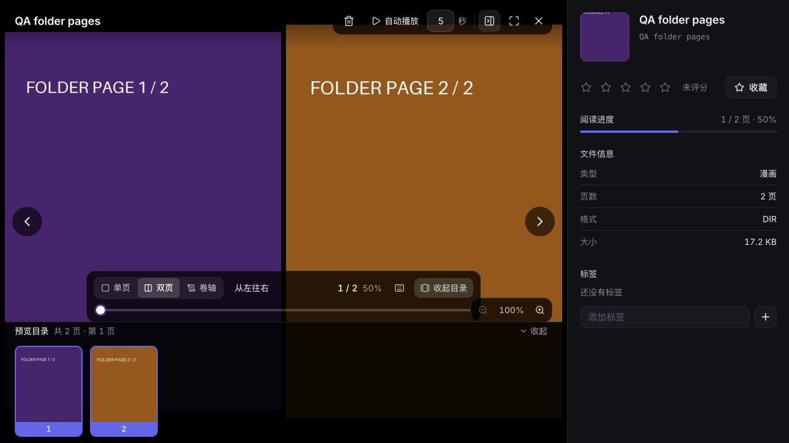
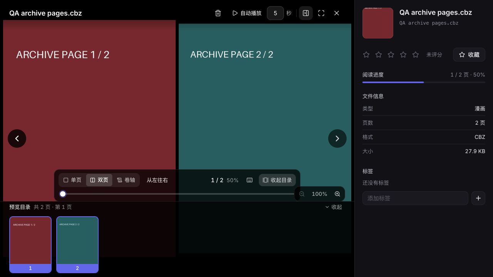

# 2026-10-23 日常 QA：漫画正文、页数与封面一致性

基线 `9eee736`；Linux 独立 worktree 与 `qa/2026-10-23-manga-pages` 分支。昨日 PR #3 已合并，今日 UI 修复已在主线；本轮未重复修改这些已完成项。当前 `AGENTS.md` 已改为不维护全局计划文件，`PLAN.md` / `FEATURE_PLANS.md` 已由主线移除，本轮依据 README 和功能文档推进，未恢复旧计划文件。

## 问题与根因

扫描计数、目录封面、压缩包封面和阅读器各自枚举图片，筛选条件不一致：

- 目录扫描计数排除了 `.he_cover`、`.thumbnails` 与处理目录，但阅读器将其中的图片加入正文，造成第一页错误、重复图片、尺寸列表及进度分母变化。
- 扫描计数与目录封面只认可五种后缀，阅读器已有 GIF/AVIF。纯 GIF 作品会被索引为 0 页且没有封面；GIF 排在首位时，封面可能错误选中后面的 PNG。
- macOS ZIP 内的 `__MACOSX` 和 `._*` AppleDouble 元数据带有图片后缀，可能被当成正文或封面候选。解码元数据失败会导致封面生成失败。
- 压缩包路径有时使用 Windows 反斜线，分类时需要识别目录层级，同时保持成员名可由 `ZipFile.open` 原样读取。

## 改动

- 新增不依赖 scanner/services 包的 `app/media_files.py`，统一图片后缀、忽略目录、目录/ZIP 枚举与排序；保留现有字典序。
- 扫描计数、封面、阅读器正文共同使用此规则。目录扫描原有的处理目录排除规则也应用于 ZIP；增加 `__MACOSX` 与 `._*` 排除，避免仅有元数据的目录成为漫画条目。
- 目录封面支持第一张 GIF 和嵌套正文；Pillow 文件句柄使用上下文关闭。
- 页面过滤会改变索引对应关系，因此服务端页缩略图采用 `_v2.jpg` 后缀，仍兼容现有按媒体 ID 的清理规则。Web/共享桌面阅读器为原图和缩略图 URL 增加 `page_set=2`，隔离旧浏览器缓存；独立杂图的流 URL 保持原有行为。
- 新增后端 12 项与前端 1 项回归，包含真实 GIF 解码、真实扫描、API 返回正文/尺寸/末页状态、旧磁盘缩略图和请求缓存版本验证。

## 验证

| 检查 | 结果 |
| --- | --- |
| 新增漫画回归在原主线运行 | 复现正文、计数、封面与旧缩略图错误；含子测试，详见运行日志 |
| 修改后漫画专项 | 12 项通过，11.61 秒 |
| 漫画与原有媒体核心专项 | 26 项通过，17.65 秒 |
| 后端全量 | 399 项通过，193.03 秒 |
| 前端 | 37 个文件、186 项通过 |
| `vue-tsc` 与 Vite 生产构建 | 通过；仅在隔离 worktree 构建 |
| 桌面核心 | 63 项通过 |
| 真实 HTTP | 目录与 CBZ 各 2 页，封面、GIF、尺寸、末页进度、越界 404、旧缩略图隔离及鉴权通过；临时 SQLite 完整性 `ok` |
| 浏览器 | 两种格式的单页/双页、两张缩略图、正文解码、版本化请求及退出返回正常；未捕获控制台 error |

后端在当前 Linux 后端镜像的一次性容器中运行，完整源码复制到容器临时目录，使用全新 SQLite、管家和配置目录，不挂载生产数据库、媒体或凭据。端到端使用实际前端生产构建、完整 FastAPI、临时账号和带明确页码的合成 PNG/GIF；目录和 CBZ 都额外放入绿色辅助封面及 AppleDouble 元数据，并预置旧页缩略图。

图片后缀覆盖测试只验证枚举契约；PNG/GIF 在 HTTP 与浏览器中实际解码。不将后缀测试描述为所有编码、动画或 AVIF 真机验收。Windows 风格 ZIP 成员名已在 Linux 回归验证，但没有 Windows/iPhone/Android 真机验收或 Electron GPU 测试。

## 兼容、剩余范围与发布边界

- 未改数据库结构、原媒体和用户设置；不批量重写旧进度或生产页数。对于原先包含辅助图片的作品，阅读器页码会因过滤而变化；现有数字进度不做内容位置迁移，需用户重新定位。
- 已有 `Media.page_count` 沿用现有行为，在打开阅读器获取 `/pages` 时更新。没有批量回填旧封面、删除旧缩略图，或触发生产重扫。
- 旧 Web 标签页和未更新的原生/桌面安装包可能继续使用旧 URL 的浏览器缓存；更新共享前端后使用新 URL，旧缓存仍按原有效期过期。
- 去重指纹与 AI 画像仍有独立的图片枚举实现，本轮源码复查发现它们也可能把辅助图纳入样本。后续统一时需先明确旧指纹/画像版本与失效策略，并覆盖人工去重决定保护；本轮不自动重算已有指纹、不改变去重结论。
- 上一轮记录的 MCP 9/24 工具历史契约差异仍待独立处理；本轮没有重复运行该已确认的失败套件，也不把它计为通过。
- Git diff 检查通过；生产主目录的两份未跟踪配置备份保留。未合并、未部署，未调用外部真实账号写入或真实媒体删除。
