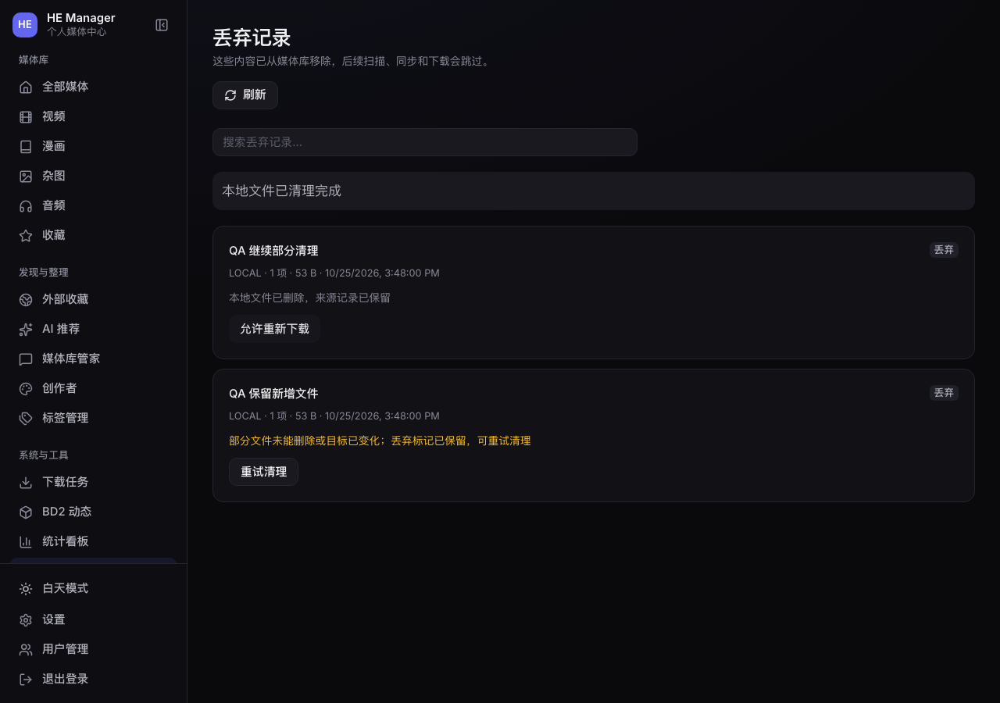

# 2026-10-25 QA：丢弃目录重试的数据保护

基线 `fa724838`，独立分支 `qa/2026-10-25-core-flows`，Linux worktree `/home/user1/he-manager-qa-20261025`。阅读 AGENTS、README、管家与前轮 QA 文档，核对最近的管家、外部来源和阅读器改动；全局计划文件已由主线移除，本轮未重建。PR #5 已合并，未重复修改此前的预览和 MCP 契约修复。

## 问题与证据

优先级 P1：目录丢弃因权限或中断未完成后，点击“重试清理”或启动恢复，可能删除之后新增或改写的文件。

`_safe_target` 已计算目录树哈希，但 `_cleanup` 对目录只核对根目录的设备号/inode，再调用 `shutil.rmtree` 递归删除。原目录 inode 不变时，其内部变化未被核对。即使在开始清理前补一次树哈希检查，递归删除期间发现的新名字仍可能被顺带删除。

在 macOS 与 Linux 原代码上，用临时 SQLite、合成媒体和一次权限故障模拟首次清理失败：最初 29 项专项中 **6 失败、23 通过**。复现新增文件、原文件内容变化、部分清理后加入新文件、清理过程中向尚未遍历的子目录加入文件，以及旧记录变化后重试；没有对生产媒体执行删除或重试。

## 实现与兼容

- 在现有 `targets_json` 保存每个子项的相对路径、类型、设备号、inode、mtime 纳秒和大小。保持现有 100,000 子项上限，新增 16 MiB 条目快照预算，超限在预览阶段拒绝；无需表结构迁移或历史回填。
- 重试先验证现存条目是获批快照的子集，允许此前已删除的旧条目；新增、改写、替换或类型变化则保留失败状态和丢弃标记。目录自身因删除子项产生的大小/时间变化不作为内容替换。
- 按核验后的有限名单逐项删除，不再递归扫除新发现的名字；未知新文件会令 `rmdir` 拒绝删除非空目录。
- POSIX 使用目录描述符与 `O_NOFOLLOW`，逐层核对身份，避免父目录被替换为符号链接后跨出获批目录。无该 API 的平台使用路径/目录连接检查；不引入 Linux 专用依赖。
- 旧记录没有逐项快照时，必须匹配原树哈希才能继续。旧记录如已部分清理或发生其他目录变化，会保守拒绝；需人工检查原目录、处理剩余内容后再重试。不会用当前目录内容重新生成“已获批”证据。目标已不存在时仍可完成恢复。
- 保留原有管理权限、明确确认、预览哈希、挂载保护、持久化丢弃标记、扫描/下载阻止及“完成清理后才允许重新下载”的规则。

## 验证

| 范围 | 结果 |
| --- | --- |
| 丢弃专项 | 35 项，含新增 14 项；覆盖部分重试、并发加入文件、旧记录、启动恢复、快照预算、描述符关闭、符号链接及无描述符 API 路径 |
| Linux 后端全量 | **433 项通过，46.64 秒**；服务器当前后端镜像的一次性隔离容器，测试数据库/临时媒体位于 tmpfs |
| macOS 后端全量 | **433 项通过，37.79 秒**；丢弃专项 **35 项通过，2.51 秒** |
| MCP | **15 项通过，无跳过**；SDK 与 HE 保持独立解释器 |
| 前端 | **40 个文件、228 项通过**；Vue 类型检查及 Vite 生产构建通过 |
| 浏览器 | 实际生产构建 + 实际登录/丢弃 API，Chromium 156：新增文件保留且不能允许重新下载；部分清理继续完成，页面出现“允许重新下载”；原始新文件字节、丢弃标记及媒体行状态验证通过，无控制台 error |
| CI | Windows 兼容任务新增本轮丢弃专项；测试临时目录使用物理路径，不放宽业务路径检查。最终 CI 状态见 PR |

Linux 容器只复制独立 worktree 源码，没有生产数据库/媒体/凭据挂载；安装测试依赖后断开网络，实际 `NetworkSettings.Networks={}`、`Binds=null`。所有删除、故障注入和恢复只涉及合成媒体。浏览器测试不连接生产 API。

## 生产只读检查与边界

- SSH 已恢复；五个生产服务报告 healthy，后端 `/healthz` 返回 `status=ok,database=ok`。
- 通过 SQLite `mode=ro`、`query_only=ON` 检查：`quick_check=ok`，媒体 2720 项；5 条丢弃记录均为 completed，没有 pending/failed 需要本轮处置。未写入生产数据库或调用生产清理接口。
- 生产主目录无未提交改动，保留原先 main 相对本地 origin/main 的 3 个提交；只在独立分支/worktree 修改。未合并、发布或部署。
- 快照是文件系统元数据证据，不读取整个媒体计算内容哈希，也不提供文件系统事务。外部进程在最后一次身份核验与同名 `unlink` 之间替换文件，仍存在很窄的竞态；更强语义需额外的隔离/恢复日志设计，本轮不宣称完全消除任意外部并发写入。
- 旧记录已部分清理后的保守拒绝是兼容代价；本轮没有自动处理生产记录。Windows 真机、网络文件系统和真实磁盘故障恢复未验收；Windows 自动测试结果以 PR CI 为准。
- 前轮记录的 Hermes 运行时旧验收与去重/画像版本策略仍待后续，不重算生产数据。
